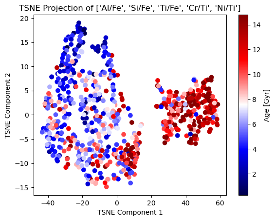

# Stellar abundance clustering with t-SNE

This bachelor’s thesis project explores how combinations of elemental abundances distinguish groups of nearby Milky Way stars. The analysis joins two stellar catalogues on Hipparcos identifier (HIP), projects selected abundances with t-SNE, and applies K-means clustering. The parallel scripts evaluate five-feature combinations by inertia.



Archived t-SNE projection for the feature combination selected by silhouette score.

## Setup

From the repository root, use Conda to create and activate the Python 3.11 environment.

```sh
conda env create -f environment.yml
conda activate bachelor-thesis
```

If you already have Python 3.11, you can instead create and use a virtual environment. On Windows, run these commands from the repository root.

```bat
python -m venv .venv
.venv\Scripts\python.exe -m pip install -r requirements.txt
```

## Data and citations

Download the original fixed-width tables from CDS VizieR. On each catalogue page, open **FTP** for the table and use **ReadMe** or the FTP listing for the plain-text column definitions. If the table downloads as a `.gz` file, decompress it before placing it in `Code/`.

| Catalogue | Files to place in `Code/` |
| --- | --- |
| [Bensby et al. (2014), J/A+A/562/A71](https://cdsarc.cds.unistra.fr/viz-bin/cat/J/A%2BA/562/A71) | `tablec3.dat` and `ReadMe` |
| [Battistini & Bensby (2015), J/A+A/577/A9](https://cdsarc.cds.unistra.fr/viz-bin/cat/J/A%2BA/577/A9) | `table5.dat` and the catalogue’s `ReadMe` renamed to `ReadMe2` |

- **`tablec3.dat`** — Bensby, T., Feltzing, S., & Oey, M. S. (2014). Exploring the Milky Way stellar disk. A detailed elemental abundance study of 714 F and G dwarf stars in the solar neighbourhood. *Astronomy & Astrophysics*, 562, A71. [DOI](https://doi.org/10.1051/0004-6361/201322631)
- **`table5.dat`** — Battistini, C., & Bensby, T. (2015). The origin and evolution of the odd-Z iron-peak elements Sc, V, Mn, and Co in the Milky Way stellar disk. *Astronomy & Astrophysics*, 577, A9. [DOI](https://doi.org/10.1051/0004-6361/201425327)

The catalogue data were accessed through VizieR, maintained by CDS in Strasbourg, France. [VizieR DOI](https://doi.org/10.26093/cds/vizier)

## Run the analysis

After adding the data, try one feature combination from the repository root.

```sh
python -c "import sys; sys.path.insert(0, 'Code'); from parallelComputing2_spyder import tsne_plot; print(tsne_plot(['Al/Fe','O/Ti','Y/Ti','[Sc/H]','[Mn/H]'], 2))"
```

For a full sweep, run either script. Each script evaluates 98,280 combinations.

```sh
python Code/parallelComputing1_spyder.py
# or
python Code/parallelComputing2_spyder.py
```

For the exploratory notebook, install the optional dependencies and launch JupyterLab. The initial VizieR queries require internet access. The saved-sweep summary runs only if you have placed `clustering_results.txt` in `Code/`.

```sh
python -m pip install -r requirements-notebook.txt
python -m jupyterlab Code/Code1.ipynb
```

On Windows, if you used the virtual environment without activating it, substitute `.venv\Scripts\python.exe` for `python` in these commands.

## Archived results and verification

The [figures](figures/) and [summary tables](results/) show archived selections by lowest inertia, highest silhouette score, and lowest p-value. The one-combination check on Windows with Python 3.11.5 joined 714 catalogue rows and ran both scripts. It produced an inertia of about 87,454 for the example combination. The corresponding archived value is about 79,684. Exact reproduction of the archived results, the full sweep, and the notebook’s live VizieR queries are unverified.
